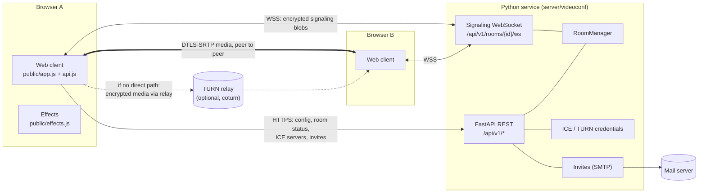
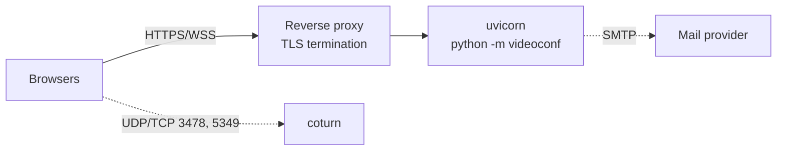

# VideoConf architecture

VideoConf is a one-to-one video calling app. A **Python service** manages connections. **Browsers** do the
media and all the cryptography, so calls stay end-to-end encrypted: the server can't see or hear them.

## Components



| Component | Where | Responsibility |
|---|---|---|
| Web client | `public/` | UI, camera/mic, WebRTC, key derivation, signaling encryption, safety code |
| API client | `public/api.js` | The only code that calls the Python service |
| Effects | `public/effects.js` | Background blur, privacy blur and virtual backgrounds, on device |
| Python service | `server/videoconf/` | Rooms and admission, signaling relay, ICE/TURN credentials, invites, static files |
| TURN (optional) | e.g. coturn | Relays encrypted packets when peers can't connect directly |

## Who manages what

| Concern | Python service | Browsers |
|---|---|---|
| Creating/tracking calls (rooms) | ✅ creates on first join, deletes when empty | derive the room ID from the call secret |
| Admission (max 2 people) | ✅ enforces it, reports it before the camera is requested, holds newcomers in a waiting state | ✅ the host's browser decides who is let in (see below) |
| Connection setup (SDP/ICE exchange) | ✅ relays the messages | ✅ create them, encrypted |
| NAT traversal | ✅ issues STUN/TURN config with short-lived TURN credentials | ✅ use them |
| Reconnection | ✅ cleans up on disconnect, notifies the other peer | ✅ reconnect with backoff |
| Invites | ✅ builds the link, sends email, rate-limits | ✅ or opens the user's own mail app |
| **Encryption keys** | ❌ never generated, stored or seen | ✅ generated from a 128-bit secret in the link's `#fragment` |
| **Media** | ❌ never passes through it | ✅ sent directly, encrypted with DTLS-SRTP |
| MITM detection | ❌ | ✅ safety code from both DTLS fingerprints |

That boundary is deliberate. If the server held keys or terminated media, it could decrypt calls and they
would no longer be end-to-end encrypted. Server-side recording, transcription or a media relay (SFU) would
require giving that up.

## Call flow

```mermaid
sequenceDiagram
    autonumber
    participant A as Browser A (host)
    participant S as Python service
    participant B as Browser B (guest)

    Note over A: secret = 128 random bits (only in the URL #fragment)<br/>roomId, signalKey = HKDF(secret)
    A->>S: GET /api/v1/rooms/{roomId}
    S-->>A: {participants: 0, joinable: true}
    A->>S: GET /api/v1/ice-servers
    S-->>A: STUN + short-lived TURN credentials
    A->>S: WS /api/v1/rooms/{roomId}/ws
    S-->>A: joined {peers: 1}
    A->>S: POST /api/v1/invites {to, secret}
    S-->>B: email with https://host/#secret

    Note over B: opens link, derives the same roomId and signalKey
    B->>S: GET /api/v1/rooms/{roomId}
    S-->>B: {participants: 1, joinable: true}
    B->>S: GET /api/v1/ice-servers, then WS connect
    S-->>B: waiting
    B->>S: knock {AES-GCM({fingerprint B})}
    S->>A: knock {id, same ciphertext}
    Note over A: decrypts the knock: known or verified device, admit automatically;<br/>otherwise ask, showing the safety code they'll get;<br/>not decryptable, deny
    A->>S: admit {id}
    S-->>B: joined {peers: 2}
    S-->>A: peer-joined

    A->>S: signal {AES-GCM(offer)}
    S->>B: signal {same ciphertext}
    B->>S: signal {AES-GCM(answer)}
    S->>A: signal {same ciphertext}
    A-->>B: ICE candidates (encrypted, via S)

    A->>B: DTLS handshake, then SRTP media directly peer to peer
    B->>A: SRTP media (both directions, never via S)
    Note over A,B: Both show safety code = SHA-256(fingerprint A, fingerprint B)<br/>Users compare it out loud
```

If the Python service restarts mid-call, media continues, because it never went through the server. Each
browser reconnects its signaling socket with exponential backoff (1 s up to 15 s), and the peers renegotiate
automatically.

## Encryption model

1. **Call secret:** 16 random bytes made by the host's browser, carried in the link after `#`. Browsers never
   send the fragment in HTTP requests.
2. **Key derivation (browser):** HKDF-SHA-256 over the secret gives:
   - `roomId`, 32 bytes as hex: the only identifier the server sees. It can't be reversed to the secret.
   - `signalKey`: an AES-256-GCM key for signaling.
3. **Signaling encryption (browser):** each SDP or ICE message is sealed with AES-GCM and a random 96-bit nonce.
   The plaintext carries a sender ID, which rejects reflected messages, and a timestamp, which rejects replays
   older than 5 minutes. The server relays ciphertext it can't read or forge, so it can't substitute its own
   DTLS fingerprints to sit in the middle.
4. **Media encryption (browser):** WebRTC's mandatory DTLS-SRTP. The UI shows the negotiated DTLS version and
   ciphers.
5. **Verification (users):** a 12-digit safety code is computed from both DTLS certificate fingerprints. If it
   matches on both screens, there's no man in the middle, even if the link leaked.
6. **Stable device identity (browser, `public/identity.js`):** each browser generates one ECDSA P-256 DTLS
   certificate, stores it in IndexedDB (the private key is non-extractable), and passes it to every
   `RTCPeerConnection`. The safety code is therefore the same for the same two devices across reconnects
   and new calls, so it only has to be checked once.
   - **Codes match** stores the code's full SHA-256 value locally, and later calls show "Verified".
   - If the other side's fingerprint differs from last time on the same link, the code is flagged as changed:
     a different device, or interception.
   - **Codes don't match** ends the call.
   - Private browsing, where IndexedDB is unavailable, falls back to one certificate per page visit and says so.

**Trade-off of server-sent invites.** To email a link, the server receives the secret once, and the link then
sits in both mailboxes. Anyone holding it could try to join while a spot is free, and the safety code is what
catches that. **Use my email app** avoids the server seeing the secret at all.

## API (v1)

The machine-readable schema is at `GET /api/v1/openapi.json`. All responses are JSON. Errors are
`{"error": "<message>"}`.

| Method & path | Purpose | Response |
|---|---|---|
| `GET /healthz` | Liveness and counters | `{status, activeRooms, connectedPeers, waitingPeers, callsStarted}` |
| `GET /metrics` | Prometheus metrics (needs `METRICS_TOKEN`) | text exposition format |
| `GET /api/v1/config` | Client feature flags | `{apiVersion, emailEnabled, roomCapacity}` |
| `GET /api/v1/ice-servers` | STUN/TURN for `RTCPeerConnection` | `{iceServers: [...], ttl: seconds\|null, iceTransportPolicy: "all"\|"relay"}` |
| `GET /api/v1/rooms/{roomId}` | Can this call be joined? | `{roomId, participants, capacity, joinable}` |
| `POST /api/v1/invites` | Email an invite. Body `{to, fromName?, note?, secret}` | `202 {status: "sent"}`; `400/403/415/429/502/503` |
| `WS /api/v1/rooms/{roomId}/ws` | Join and signal | see below |

**Signaling messages**

| Direction | Message |
|---|---|
| server → client | `{"type":"joined","peers":n,"host":bool}`, `{"type":"waiting"}`, `{"type":"knock","id":"…","data":"<ciphertext>"}`, `{"type":"knock-cancelled","id":"…"}`, `{"type":"denied"}` (then close `4403`), `{"type":"peer-joined"}`, `{"type":"peer-left"}`, `{"type":"signal","data":"<ciphertext>"}`, `{"type":"full"}` (then close `4409`) |
| client → server | members: `{"type":"signal","data":"<ciphertext>"}`, `{"type":"admit","id":"…"}`, `{"type":"deny","id":"…"}`; waiting: `{"type":"knock","data":"<ciphertext>"}` |

Only admitted members can signal each other. A waiting peer's `signal`, `admit` and `deny` messages are ignored.
If the last member leaves, the longest-waiting peer is promoted and becomes the host.

`roomId` must be 64 lowercase hex characters. Messages over 64 KB close the socket (`1009`). A foreign
`Origin` is refused (`1008`). Per-IP connection limits close with `1013` (try again later).

## Admission ("knock to join")

The first person in an empty call is admitted. Anyone who arrives while someone is already there waits:

1. The newcomer's browser sends a **knock** encrypted with the call's signaling key. It contains the
   newcomer's device fingerprint. The server forwards it without being able to read it.
2. The host's browser decrypts it and decides:
   - **Doesn't decrypt:** the sender doesn't really have the link, for example someone who only knows the
     room ID, or a misbehaving server. Denied automatically.
   - **The same device that was last connected on this link**, which covers reconnects after a network blip
     or server restart, **or a device whose code you marked "Codes match"**: admitted automatically.
   - **Anyone else:** the host is asked *"Someone with the link wants to join"*, and is shown the safety code
     they will see if they let them in.
3. Denied newcomers are disconnected (`4403`) and don't retry.

Admission is a convenience control enforced by the server, layered on top of the cryptography. A malicious
server could skip it, but still couldn't read anything without the call secret, and the safety code still
exposes interception. Expiring links were considered and left out: with admission, an old link can only start
a new, empty call, which exposes nothing.

## Server hardening

- **Origin checks** on the WebSocket and on invites, which blocks cross-site WebSocket hijacking and form posts. Invites
  also require `application/json`.
- **Invite abuse:** the server builds the link itself, so only a well-formed secret is accepted and arbitrary
  URLs can't be emailed. Each request has one recipient, newlines are stripped from header fields, the HTML is
  escaped, and each IP gets a sliding-window limit (default 5 per 15 minutes).
- **SMTP:** STARTTLS is required on port 587; port 465 uses implicit TLS.
- **TURN:** credentials are short-lived (coturn `use-auth-secret` / TURN REST), so the long-term secret
  never reaches browsers.
- **Headers:** a strict CSP (scripts only from this origin, plus `wasm-unsafe-eval` for on-device effects),
  `nosniff`, `no-referrer`, a Permissions-Policy for camera and mic, and `no-store` on API responses.
- **Static files:** effects assets are served from an explicit allowlist; the rest is confined to `public/`.
- **Connection limits (per client IP):** 20 concurrent signaling sockets, 60 new sockets per minute, and
  120 room-status checks per minute. All are configurable. Rejections are counted in metrics.
- **Metrics:** Prometheus text at `/metrics`, enabled only when `METRICS_TOKEN` is set, and requiring
  `Authorization: Bearer <token>`. It reports gauges for active rooms, connected and waiting peers, calls
  started, admissions and denials, and counters for invites by result and rejections by reason. Logs carry only
  the first 8 hex digits of a room ID.
- **State:** rooms and rate limits are in memory. Running several server instances needs either sticky
  routing by `roomId` or a shared store such as Redis pub/sub. See "Scaling" below.

## Deployment

Step-by-step guide and production configs: [DEPLOYMENT.md](DEPLOYMENT.md) (`Dockerfile`, `deploy/`).



- Run behind a TLS proxy such as nginx, Caddy or a cloud load balancer, with WebSocket upgrade enabled. Set
  `PUBLIC_URL` and `TRUST_PROXY=1`. Or let uvicorn serve TLS directly with `TLS_CERT`/`TLS_KEY`.
- **Scaling:** a single instance handles many thousands of idle signaling sockets, because media doesn't
  touch it. For more than one instance, route by `roomId` (consistent hashing at the proxy) or move
  `RoomManager` to Redis pub/sub.
